# 爱英语学习 - 墨小灵

面向小学生的英语学习网站。学生可以按教材单元听写单词、跟读课文，也可以按上课日期复习「李校来啦」的课堂讲义。首页每天从词书中选出一个单词，提供英美发音、双语例句和向墨小灵提问的入口。

[快速开始](#快速开始) · [产品示例](#产品示例) · [分功能截图](#学习功能) · [更新学习资料](#更新学习资料)

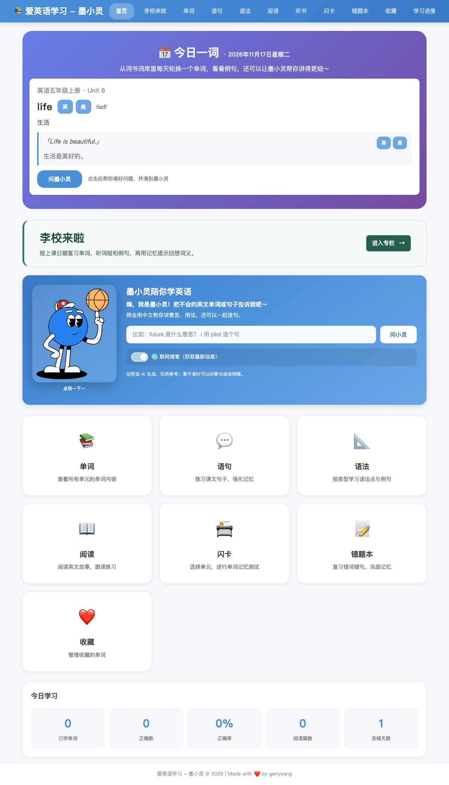

## 快速开始

在项目根目录运行以下命令。网站使用 Python 3、Flask 和 Gunicorn，前端无需构建。Node.js 用于命令行教材转换。

```bash
./optools.sh install
./optools.sh start
```

启动后打开[本机首页](http://localhost:8082/)。同一局域网的平板或手机可使用启动信息中显示的局域网地址。听写、阅读、时态测验和课堂专栏均可直接使用，朗读使用设备提供的语音。

`./optools.sh check-env` 可检查依赖与教材文件，`./optools.sh init` 与 `install` 等效。`status` 查看服务状态，`restart` 重启，`stop` 停止，例如 `./optools.sh stop`。

## 产品示例

以下链接在本机服务启动后可直接打开对应的教材或练习。

### 从单词 pilot 到课文《My future》

1. 在「闪卡」选择「英语五年级上册」的 Unit 1，再选「英文 → 中文」。翻到 **pilot** 时，先回忆词义，再点「查看答案」核对「飞行员」和例句 *My uncle is a pilot.* 点单词旁的爱心即可收藏。
2. 在同单元的阅读里，点 Joe 台词旁的播放键，跟读 *I want to be a pilot. I want to fly a plane in the sky.* 读完点「标记已读」，就能在「学习进度」查看记录。[打开课文《My future》](http://localhost:8082/?page=readings&item=reading-001)
3. 在「听书」打开同一课的「正文」，将速度调到 0.75 倍，连续听老师的提问和同学们的回答。[打开《My future》听书正文](http://localhost:8082/?page=speech&item=speech-001&chapter=0)

### 复习一节「李校来啦」课堂词汇

打开 2026 年 11 月 6 日的「日常表达与安全」。第一项是 **express**（表达）。依次点词组 *express an idea* 和例句 *I express my ideas in pictures.* 旁的「朗读」，听听同一个词在短语和整句里的读法。点「本课原始讲义」可打开这节课的中英文、英文、中文或音标 PDF，点「打印本课」可打印当前课程。[打开这节课](http://localhost:8082/?page=li-school&date=2026-11-06)

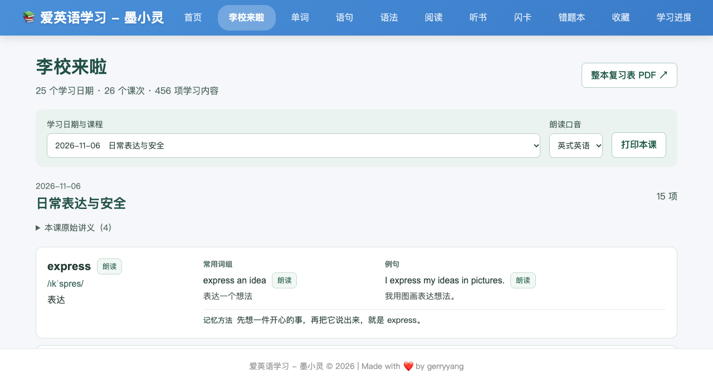

### 用一道题练习一般现在时

打开「语法 → 时态」，找到题目「My sister `______` to school by bus every day.」 选项是 `go`、`goes`、`going`。这里选 **goes**，因为 *every day* 表示习惯，主语 *My sister* 是第三人称单数。完成整套题并提交后，可以逐题看解析，也能按时态查看正确率和薄弱知识点。[打开时态魔法学院](http://localhost:8082/?page=grammar&item=tenses)

## 学习功能

点击截图可查看原图。下面用五年级上册 Unit 1 的词汇和课文演示听写、翻卡、跟读和复习。

| 单词听写 | 闪卡 |
| --- | --- |
| [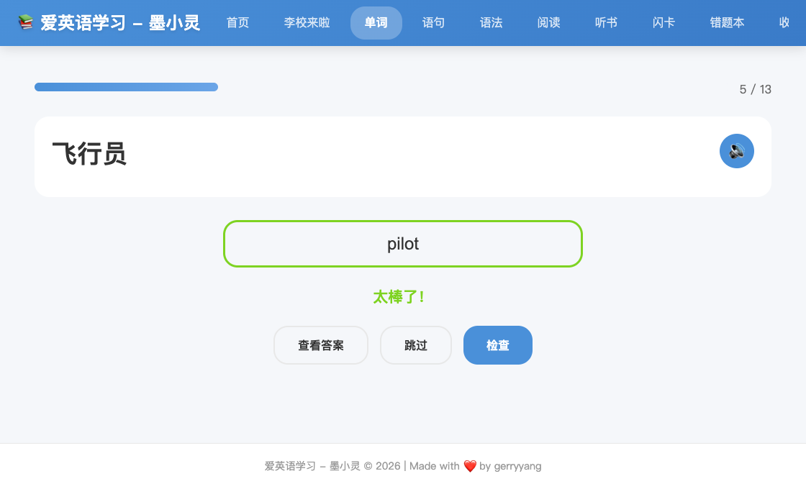](docs/screenshots/word-dictation.png) | [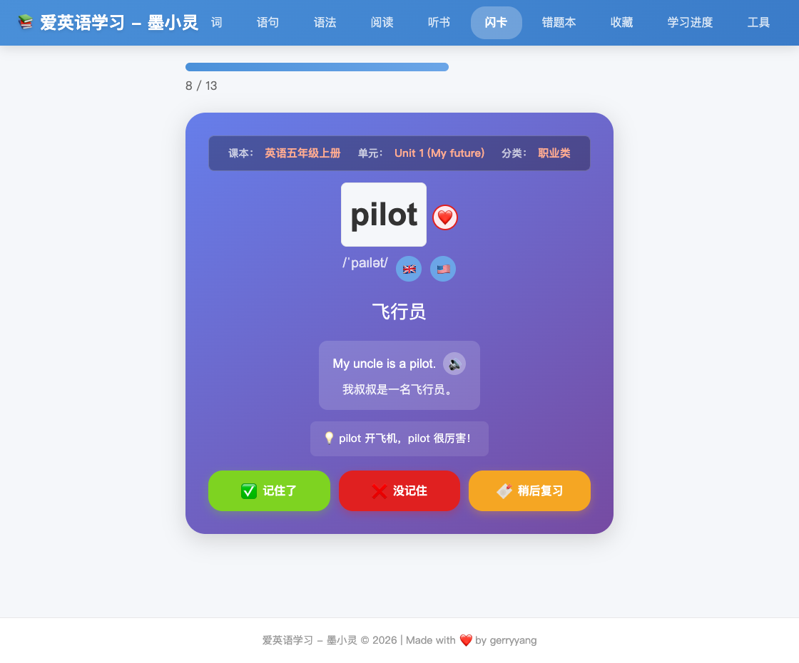](docs/screenshots/flashcard.png) |
| 根据「飞行员」的中文提示或发音输入 `pilot`，点「检查」核对拼写。 | 可选多个单元，以英译中、中译英或混合模式测试。翻卡后可听英美发音，再选「记住了」「没记住」或「稍后复习」。 |

| 阅读跟读 | 听书 |
| --- | --- |
| [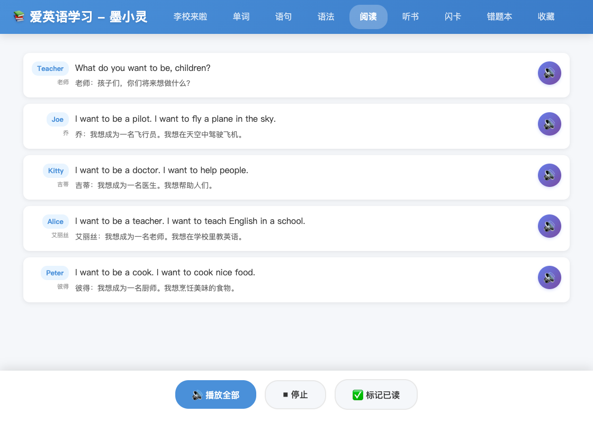](docs/screenshots/reading-dialogue.png) | [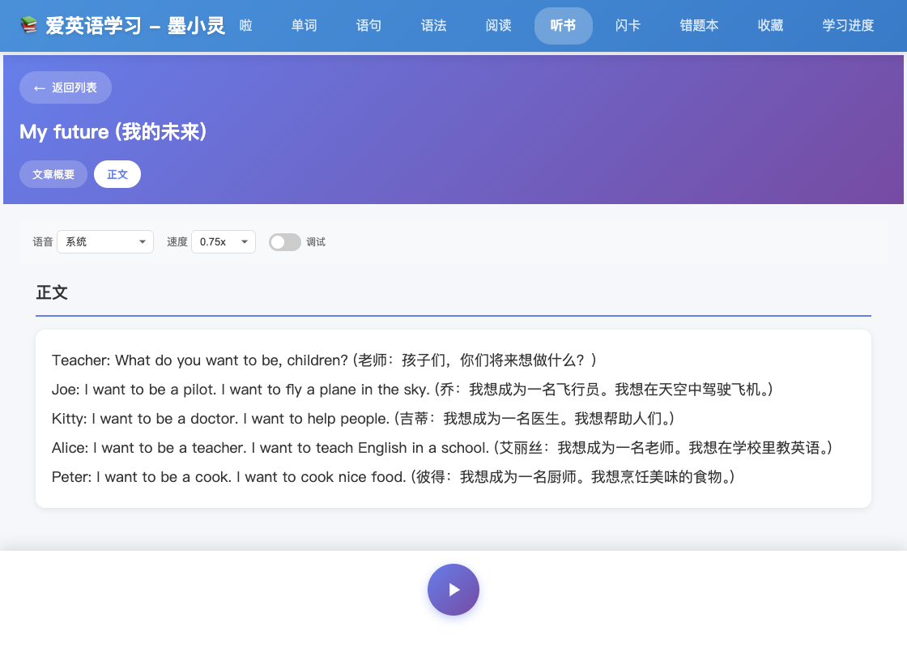](docs/screenshots/audiobook.png) |
| 点 Joe 旁边的喇叭，只听他的回答。也可播放整段对话、查看重点句型，并在读完后标记已读。 | 同一篇课文也可按章节连续播放。图中选择了「正文」和 0.75 倍速，方便逐句跟读。 |

| 语句练习 | 语法测验 |
| --- | --- |
| [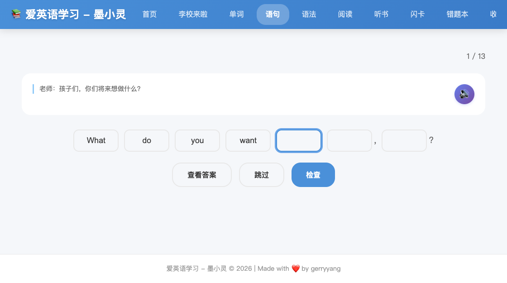](docs/screenshots/sentence-practice.png) | [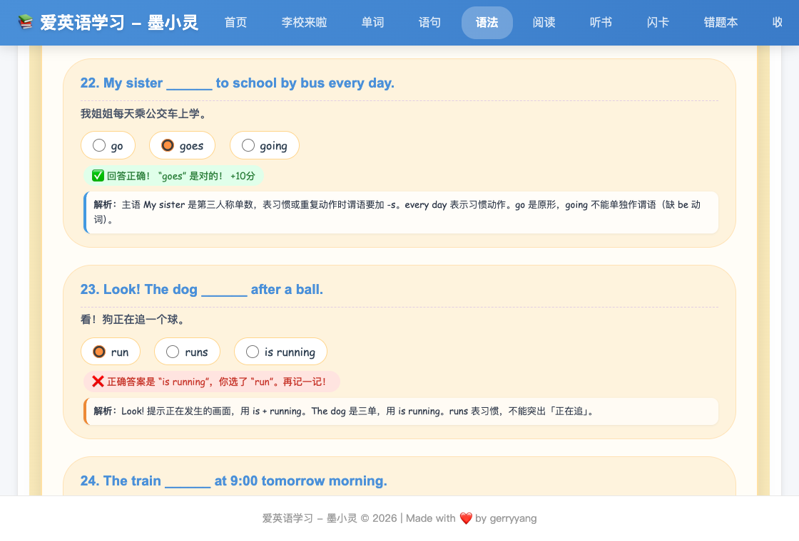](docs/screenshots/grammar-quiz.png) |
| 听老师问 *What do you want to be, children?*，对照中文逐词填写，完成后点「检查」。 | 「时态魔法学院」讲解一般现在时、现在进行时和将来时。完成混合测验后，可查看每题解析及各时态的正确率。 |

| 错题本 | 收藏 |
| --- | --- |
| [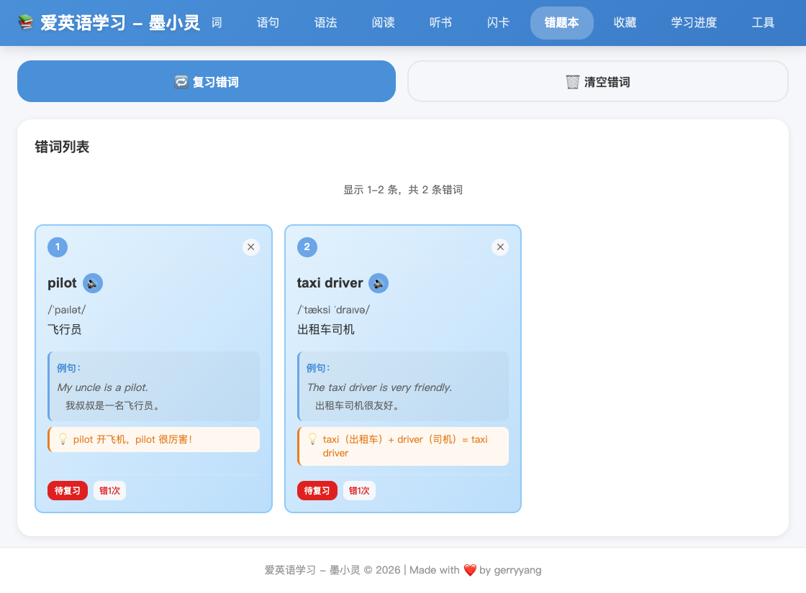](docs/screenshots/wrongbook.png) | [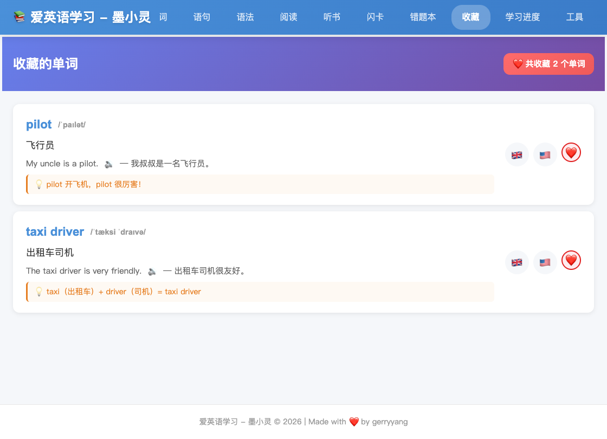](docs/screenshots/favorites.png) |
| 选「错词」或「错句」可分别重练。图中的两个词来自这次闪卡练习中标记的「稍后复习」。 | 翻卡时点爱心即可收藏。回到收藏页，可以重听单词和例句，或取消收藏。 |

| 学习进度 | 教材更新工具 |
| --- | --- |
| [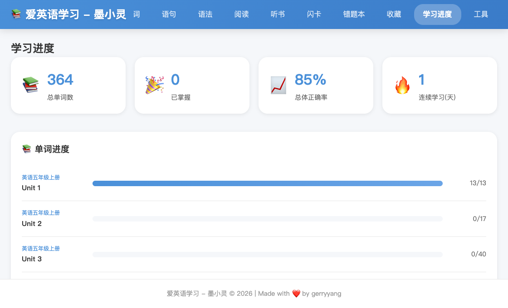](docs/screenshots/progress.png) | [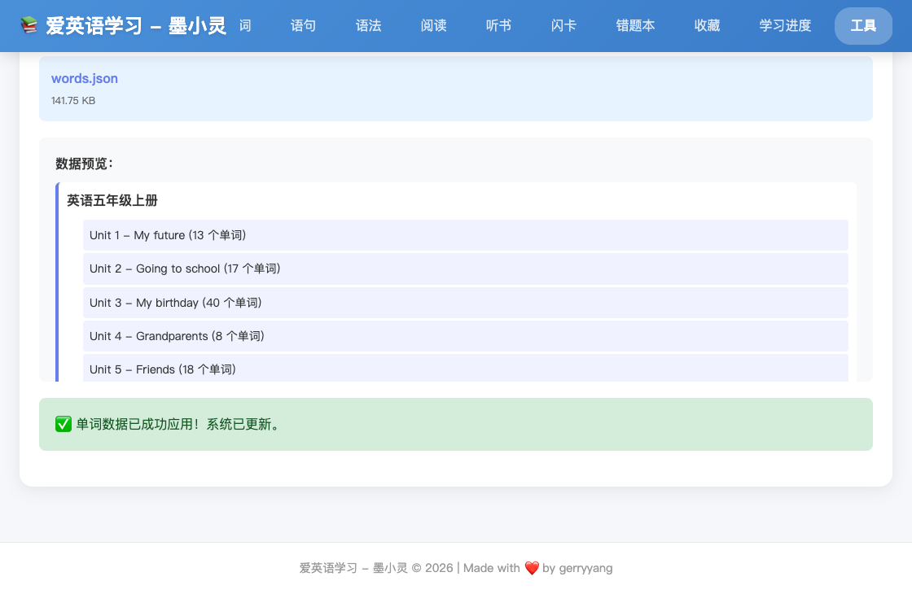](docs/screenshots/data-tools.png) |
| 做完一轮闪卡后，可查看本单元的已学词数、总体正确率和连续学习天数。单词和阅读记录保存在当前浏览器中。 | 导入 JSON 后可按书本、单元核对内容。也支持上传 Markdown 生成单词、阅读或听书数据。 |

首页「今日一词」按北京时间轮换，点「问墨小灵」可带着这个词提问，也能自己输入「用 pilot 造个句」。课堂讲义、打印和英美式朗读另见[「李校来啦」课程示例](#复习一节李校来啦课堂词汇)。

### 启用 AI 问答与自定义音色

使用环境变量配置时，在启动服务的终端设置 `MINIMAX_API_KEY`。听书需要复刻音色时，再将 `MINIMAX_VOICE_CLONE_FILE_ID` 设为已上传参考音频的文件 ID。服务已启动时，运行 `./optools.sh restart` 让配置生效。

如果需要指定模型、限流或配置多个音色，可将配置模板复制为 `api_config.py`（`cp api_config.example.py api_config.py`）。服务优先读取这个文件。将其中的密钥赋值改为从环境变量读取，再按需填写 `MINIMAX_VOICE_CLONE_VOICES` 中每个音色的 `file_id` 和 `description`。[配置模板](api_config.example.py)

```python
import os

MINIMAX_API_KEY = os.environ['MINIMAX_API_KEY']
```

## 更新学习资料

导航栏的「工具」支持上传 Markdown、预览并下载 JSON，也支持导入 JSON 在当前页面试用。要让所有访问者加载新教材，将生成的文件保存到仓库对应的 `data/` 路径。

| 教材 | Markdown 源文件 | 网站加载的数据 | 检查与转换命令（依次运行） |
| --- | --- | --- | --- |
| 单词与例句 | [WORDS.md](data/WORDS.md) | [words.json](data/words.json) | `./optools.sh check-words`、`./optools.sh convert-words` |
| 阅读课文 | [READINGS.md](data/READINGS.md) | [readings.json](data/readings.json) | `./optools.sh check-readings`、`./optools.sh convert-readings` |
| 听书 | [LISTEN.md](data/LISTEN.md) | [listen.json](data/listen.json) | `./optools.sh check-listens`、`./optools.sh convert-listens` |

「李校来啦」使用独立的课程底稿。在学习目录用 `$primary-english-wordlist` 更新底稿后，从本项目根目录运行以下命令。将示例路径换成含有 `单词表数据/课程.json`、原始讲义和整本复习表 PDF 的目录。脚本核对讲义后，将资料同步到 [content/li-school/](content/li-school/)。

```bash
python3 scripts/sync-li-school.py "/path/to/李校来啦"
```

## 项目导航

- 网页结构和样式见 [index.html](index.html) 和 [css/](css/)。学习流程在 [js/app.js](js/app.js)，课堂专栏在 [js/li-school.js](js/li-school.js)。
- 静态文件服务、MiniMax 问答和音色接口见 [server.py](server.py)。首页动画的选择方式见 [墨小灵形象说明](lottie/README.md)。
- 更多资料见[教材脚本说明](scripts/README.md)、[设计文档](DESIGN.md)、[更新记录](CHANGELOG.md)和[参考教材 ChinaTextbook](https://github.com/gerryyang2025/ChinaTextbook)。
